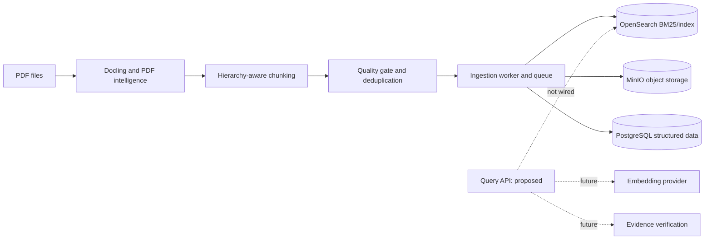

# GroundStack

[](https://github.com/mangopep/rag_platform/actions/workflows/ci.yml)

**Open-source infrastructure for evidence-grounded intelligence.**

GroundStack is an early-stage Python repository for document parsing, chunking, indexing, and retrieval experiments. It aims to make source evidence, provenance, and operational limits visible in knowledge systems.

> **Status: experimental / not production-ready.** This repository has meaningful PDF ingestion, chunking, object-store and search-store code, plus unit and integration tests. The API currently exposes only a basic root and health response. End-to-end retrieval and answer generation are not wired into it. Authentication, tenant isolation, claim-level verification, backup/restore, and production deployment are not implemented. See the [implementation status](docs/architecture/overview.md#implementation-status).

## Why GroundStack

RAG systems often return fluent text without making it easy to inspect which source passage supports a claim, what was omitted, or how a document reached the index. GroundStack's design goal is an inspectable pipeline: retain source identity and page metadata, make retrieval steps replaceable, and evaluate retrieval and citations separately from generation.

Principles:

- **Evidence before fluency:** generated answers should be traceable to retrieved source passages.
- **Explicit implementation status:** proposed components are not presented as working features.
- **Local-first by default:** documents should remain in the operator's environment unless they choose an external provider.
- **Replaceable boundaries:** storage, embedding, parser, and model integrations should have narrow interfaces.
- **Measured claims:** publish benchmark results only with corpus, hardware, configuration, and reproducible commands.

## Current capabilities

| Capability | Status |
|---|---|
| PDF parsing / document intelligence | Implemented code in `src/ingestion`; requires dependency and integration verification |
| Hierarchy-aware chunking and code detection | Implemented; covered by unit tests |
| OpenSearch indexing / BM25 store | Implemented code; requires a running OpenSearch service for integration |
| MinIO document store | Implemented code; integration tests require MinIO |
| PostgreSQL structured knowledge store | Implemented code; service-backed tests require PostgreSQL |
| Background task queue and ingestion worker | Implemented code; persistence and recovery need deployment-level validation |
| Vector embeddings and vector retrieval | Placeholder modules; no complete wired path |
| Query-to-answer API | Not implemented; API routes are empty |
| Knowledge graph extraction and resolution | Not implemented as an end-to-end pipeline |
| Auth, tenant isolation, rate limiting | Not implemented |
| UI | Static responsive preview implemented; ingestion/query controls are not connected |

## Architecture at a glance



The diagram's solid path describes code present in the repository; dashed edges are proposed. More detail is in [architecture overview](docs/architecture/overview.md), [ingestion](docs/architecture/ingestion.md), and [retrieval](docs/architecture/retrieval.md).

## Getting started

### Requirements

- Python 3.11 or newer
- Docker Compose v2 for service-backed integration
- macOS or Linux (Windows via WSL2 is not yet validated)
- Disk/RAM requirements depend heavily on Docling and OCR dependencies; an 8 GB profile has not been validated

### Install Python dependencies

The current dependency set includes heavyweight document/OCR and evaluation packages. Installation size and time can be significant.

```bash
python3 -m venv .venv
source .venv/bin/activate
python -m pip install --upgrade pip
python -m pip install -e '.[dev]'
```

### Start the development services

Compose currently starts PostgreSQL/AGE, OpenSearch, Redis, MinIO, and Langfuse. It is a development topology, not production-hardened. Review configuration and supply unique credentials before starting:

```bash
test -f .env || cp .env.example .env
# Replace the sample values with unique random credentials before starting.
docker compose up -d
```

See [configuration](docs/guides/configuration.md), [development guide](docs/guides/local-development.md), and [deployment status](docs/architecture/deployment.md). There is no verified one-command end-to-end demo yet; avoid putting private documents into this experimental stack.

## Ingestion code entry points

A folder watcher and ingestion worker are present. Their actual service integrations need to be configured and verified against a live stack. See [document ingestion](docs/guides/document-ingestion.md) before using them. Do not treat a successful parser run as evidence that indexing, retrieval, or answering works end to end.

## API

The current API can be started with:

```bash
uvicorn src.api.main:app --reload --port 8000
```

`GET /` returns a running message and `GET /health` returns a basic process response. These are not dependency readiness checks. There are no implemented ingest or query routes yet. See [API reference](docs/api/reference.md).

## Workspace interface

An early responsive workspace preview is available at `http://localhost:8000/workspace/` when the API server is running. It uses a consistent custom line-icon system and responsive layouts. The interface clearly labels unavailable capabilities; document upload and querying are not connected because their API flows are not implemented. It makes no claims about indexed documents or answer quality.

## Testing and evaluation

```bash
pytest
```

Unit tests cover chunking, stores, worker, queue, and watcher logic. Integration tests need their backing services and fixtures. In this environment no test runner was installed in the checked-in `.venv`, so test results are **NOT TESTED**. Benchmark methodology and unmeasured metrics are documented in [evaluation methodology](docs/evaluation/methodology.md) and [benchmarks](docs/evaluation/benchmarks.md).

## Repository layout

```text
src/        application modules
scripts/    service initialization, ingestion, verification, and maintenance commands
tests/      unit, integration, and evaluation harnesses
docs/       architecture, operating guides, API, and evaluation notes
data/       empty tracked directories; do not commit user documents or generated indexes
```

## Security and privacy

No production security guarantees are currently provided. Compose now requires secrets from `.env`, OpenSearch security is disabled, and the API has no authentication or document authorization. The application does not intentionally upload documents through the API, but optional model/telemetry integrations can involve network traffic when enabled. Do not expose the stack to untrusted networks or ingest sensitive data until the [security guide](docs/architecture/security.md) requirements are implemented and reviewed.

Report vulnerabilities privately using the process in [SECURITY.md](SECURITY.md).

## Contributing

Contributions are welcome, especially focused fixes to ingestion correctness, reproducible tests, and clear documentation. Read [CONTRIBUTING.md](CONTRIBUTING.md), [Code of Conduct](CODE_OF_CONDUCT.md), and the ADRs before proposing architectural dependencies.

## Roadmap

See [ROADMAP.md](ROADMAP.md) for prioritized work and [CHANGELOG.md](CHANGELOG.md) for repository changes.

## Name availability note

A preliminary public search found existing GitHub repositories named [aashish-b/groundstack](https://github.com/aashish-b/groundstack) and [orbital-state/groundstack](https://github.com/orbital-state/groundstack), among others. PyPI and npm exact package lookups returned 404 on 2026-11-26. This does **not** establish trademark clearance or GitHub organization/repository-name availability. The project name should be treated as provisional pending a proper trademark and namespace review. No repository rename or publication was performed.

## License

This project is licensed under the MIT License; see [LICENSE](LICENSE).

## Acknowledgements

GroundStack builds on upstream projects including Docling, PyMuPDF, Apache AGE, PostgreSQL, OpenSearch, Redis, MinIO, FastAPI, Ollama, Langfuse, and RAGAS. Their licenses and versions should be reviewed before redistribution; see `pyproject.toml` and upstream project documentation.
