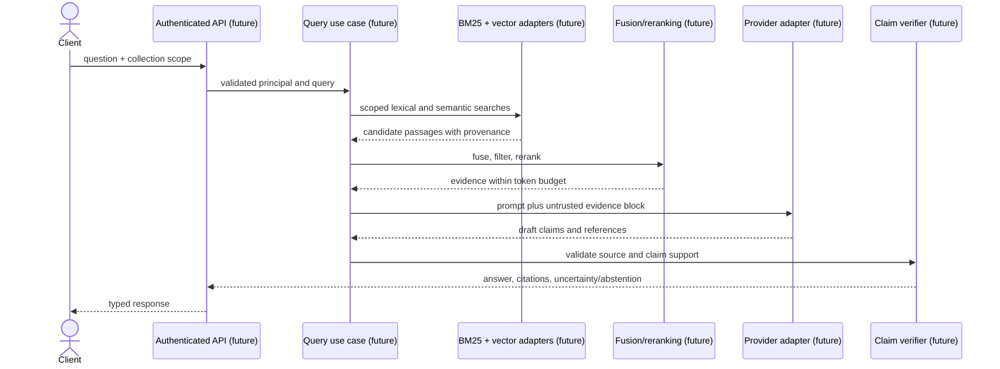

# Proposed query sequence

Every participant above is proposed except the standalone BM25 adapter and Ollama wrapper. Authorization, fusion, generation orchestration, and verification are absent today.
