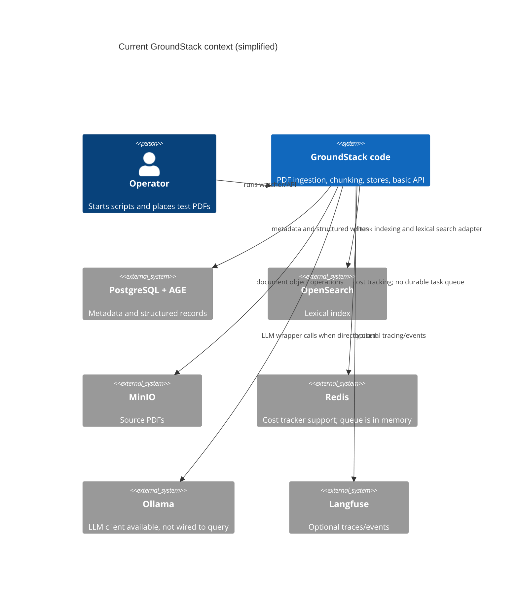

# HLD: System context

## Current actors and external systems

- **Operator:** runs scripts, starts services, and places test PDFs in a watched folder.
- **FastAPI client:** can request a root message or process health. There is no document/query API.
- **PDF parser:** Docling converts native documents; PyMuPDF classifies pages and supplies fallback text.
- **Persistence services:** PostgreSQL/AGE, OpenSearch, MinIO, Redis, and Langfuse are declared in Compose. Only selected stores are called by the ingestion path.
- **Ollama:** host process for `LLMClient`; no query endpoint invokes the client.

## Current context diagram

The diagram uses current code relationships, not proof that all external calls were exercised together. The task queue is an in-process Python heap, not Redis.
