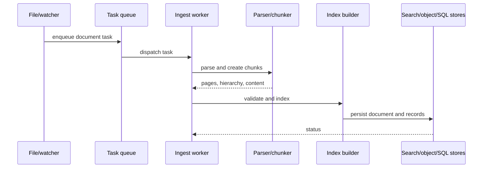

# Ingestion architecture

## Present path

The repository contains PDF intelligence, chunking, quality-gate, deduplication, index-builder, watcher, and worker modules. A worker delegates file processing to the ingestion pipeline and interacts with stores. This is not yet exposed through a working HTTP ingestion route; service-backed execution must be tested before relying on it.

The sequence represents intended calls inferred from existing modules; verify exact adapters and side effects before treating it as a production execution trace.

## Target requirements

Use content hashes for idempotency; record source version, parser version, chunker version, tenant/collection, and page provenance. Make each job resumable with explicit states and bounded retries. Persist a manifest so deletion and reindexing can reconcile all stores. Never mark a document complete until every required write is confirmed or compensated.

OCR, table/image extraction, command fidelity, interruption recovery, and duplicate behavior require representative fixture-based tests. Current test names cover some PDF robustness and chunking cases, but no complete real-stack validation was performed in this audit.
