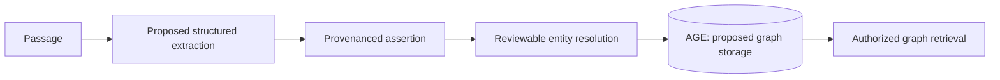

# Knowledge graph

Apache AGE is included in the development database image and a knowledge-graph store module exists, but extraction, entity resolution, graph writes, and graph-assisted retrieval are not established as a complete working feature.

Proposed flow: extract candidate entities and typed relations from a source passage; retain passage ID, page, extraction method/model, and confidence on every assertion; resolve entities using deterministic identifiers and reviewable rules; preserve conflicting assertions rather than silently overwriting them. Graph traversal must obey the same document and tenant authorization filters as search.

