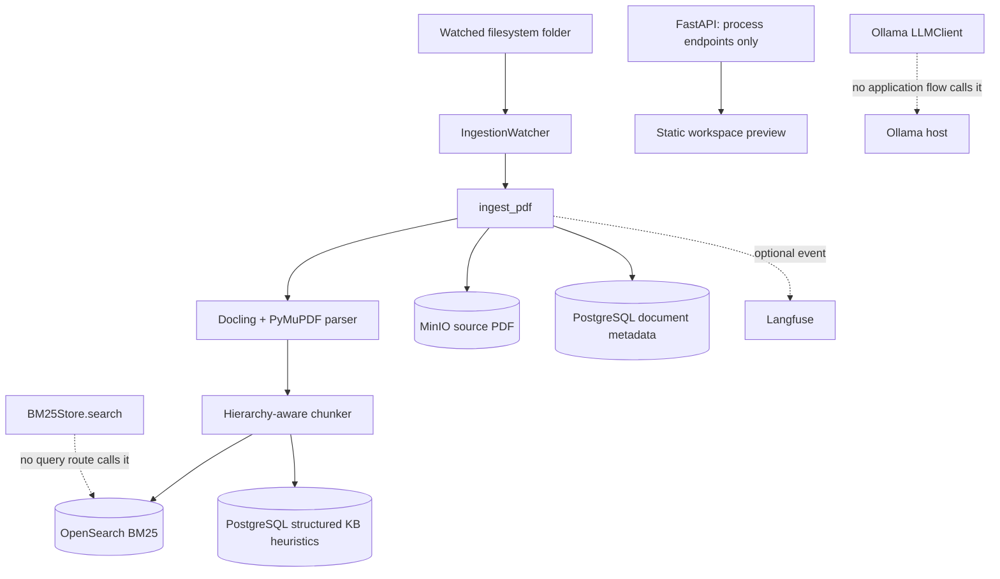
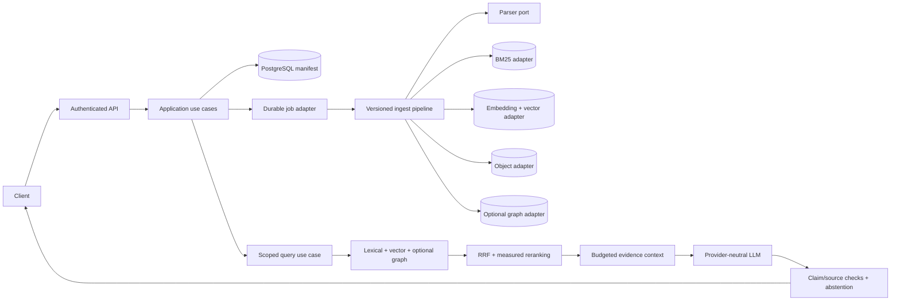

# Architecture overview

This page separates current implementation from target design. Solid edges are current only when called by the checked source path; dashed edges are proposed.

## Current implementation

## Proposed target boundary

Dashed/target components are design directions only. For current truth, see the [status matrix](../project/implementation-status.md).
