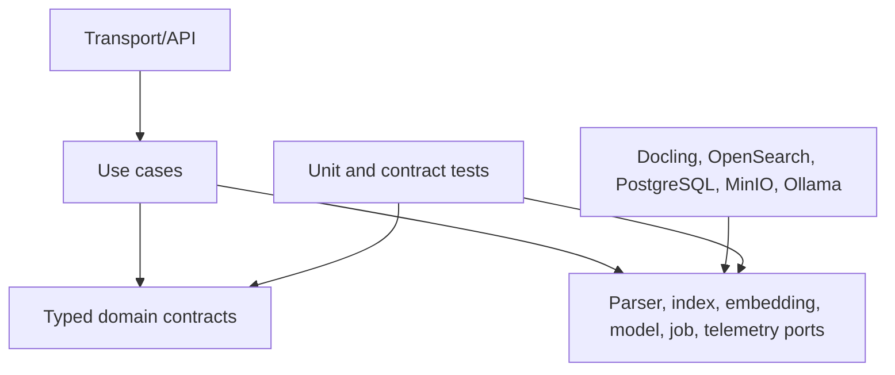

# Architecture overview

## Current implementation

This is a Python package organized by capability: ingestion, workers, stores, query, retrieval, answer, API, and configuration. The repository has code for document parsing/chunking/index construction, a task queue/worker, OpenSearch BM25, MinIO document storage, and PostgreSQL structured knowledge. The FastAPI app in `src/api/main.py` currently exposes only `/` and `/health`; the other route modules are empty. Several retrieval, embedding, graph, verification, and API modules are empty placeholders.

## Implementation status

| Area | Status | Evidence |
|---|---|---|
| PDF parsing/chunking/index builder | Code implemented; external integration not verified here | `src/ingestion/` |
| Queue/worker | Code implemented; service reliability not validated | `src/workers/` |
| BM25 / OpenSearch | Code implemented; service-backed checks needed | `src/stores/bm25.py` |
| Object and structured stores | Code implemented; live integration not verified | `src/stores/doc_store.py`, `structured_kb.py` |
| Embeddings/vector retrieval | Not complete | placeholder modules |
| Query orchestration / answer generation / citations | Not wired | `src/query/`, `src/retrieval/`, `src/answer/` |
| Graph extraction / entity resolution | Not wired end to end | `src/stores/knowledge_graph.py` placeholder |
| Authentication / tenant isolation / rate limiting | Not implemented | middleware placeholder |
| UI | Static responsive preview only; features are not connected | `web/` |
| Production deployment | Not implemented | none |
| Benchmarks | Not measured | harness files are not reported results |

## Proposed dependency direction

This is a target boundary, not a description of current wiring. New infrastructure should only be added when a use case and measurable operational need justify it.
