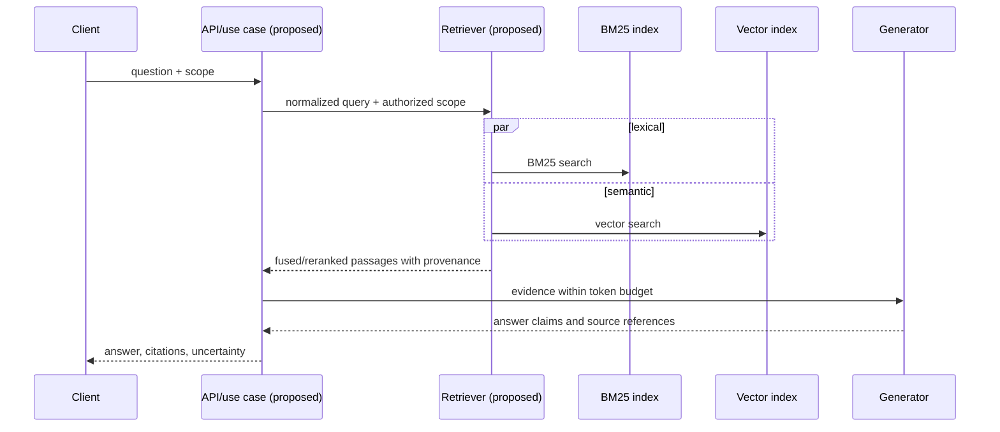

# Retrieval architecture

## Current state

OpenSearch BM25 code exists. Vector search and embeddings are not implemented as a complete path. Query rewriting, routing, retrieval fusion, reranking, context assembly, and response generation are not connected to the API.

## Proposed query flow

This is proposed architecture only. Scope filtering must happen inside each backend query, not after results are returned. Reciprocal Rank Fusion and reranking should be configurable and evaluated against a labeled corpus before becoming defaults.
