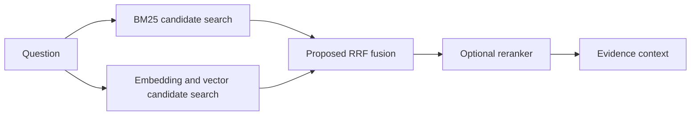

# Hybrid retrieval

Hybrid retrieval combines lexical and semantic search. A common approach runs BM25 and vector search independently, then combines ranked lists with Reciprocal Rank Fusion (RRF), which uses rank positions rather than assuming score scales are comparable. A reranker can then reorder the candidate set.

GroundStack currently has only the BM25 adapter. There is no vector provider, RRF implementation, reranker, or query router. The diagram below is a proposed future design:

