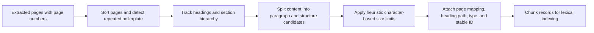

# Chunking engine

`src/ingestion/chunker.py` turns valid native `PageResult`s into `ChunkResult`s. It sorts pages, detects repeated non-heading lines across documents above a minimum page threshold, tracks a heading hierarchy, preserves page mappings, and emits content/section/table/code records. Stable hash helpers form IDs. Short isolated sections may stay below the best-effort minimum so the chunker does not merge unrelated sections.

## Chunking flow

For example, a page headed `## Database` with a few short paragraphs becomes chunk records that retain the `Database` heading path and source page. A long technical paragraph is split while retaining its page attribution. Repeated page headers may be omitted when they meet the cross-page boilerplate threshold. The implementation emits no embedding vectors and does not claim that its character estimate equals a tokenizer's token count.

Token length is estimated from character count, not a model tokenizer. The cap is therefore a heuristic, not a guarantee against any model's context overflow. Work is expected O(N) in extracted text and line count, with O(N + C) working/output memory, where N is input text and C is emitted chunks; no worst-case parser bound is claimed.

To change behavior, add a focused fixture for headings, technical commands, tables, page attribution, repeated boilerplate, and long paragraphs; run `tests/unit/test_chunker.py` and inspect output. Do not change ID inputs without planning reindex compatibility.
