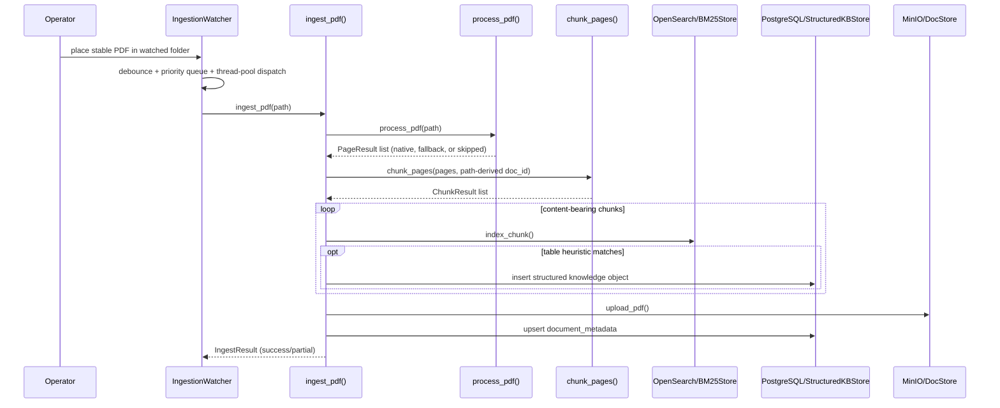

# Current state

**Audit snapshot:** commit `c452050e480754f4b209669e0363c9b1e86fb7fb` (`main`), 2026-11-26. The working tree was clean. Local `.env`, virtual-environment files, generated caches, and corpus documents are ignored or untracked and were left untouched; their contents were not inspected.

This report records the starting-state audit, not the latest engineering foundation. Follow-up changes and current verification are tracked in [implementation status](implementation-status.md), [testing strategy](../quality/testing-strategy.md), and [CI/CD](../infrastructure/cicd.md).

## What GroundStack is

GroundStack is an experimental Python document-ingestion and lexical-search repository. The implemented core extracts text from PDFs, creates structured chunks, indexes them into OpenSearch, derives a small set of structured records from tables, stores original PDFs in MinIO, writes metadata in PostgreSQL, and emits optional Langfuse events. It also has an in-memory async task queue, a filesystem watcher, and an early static workspace interface.

It is **not yet a usable question-answering RAG product**. There is no complete query API, embedding implementation, vector retrieval path, graph extraction path, answer generation/verification pipeline, authentication, tenant isolation, or production deployment profile.

## Baseline evidence

- Starting-state baseline only: `/.venv/bin/python -m pytest -q` reported **257 passed, 12 skipped** on Python 3.11.15, pytest 9.2.0; 11 dependency deprecation/future warnings. This is not the current test result or an end-to-end platform proof.
- The PDF robustness tests executed locally, including a 20-page synthetic PDF. Docling sometimes returned empty page text, and the parser reported `partial_fallback` after using PyMuPDF. Scanned pages without extractable text are skipped; OCR is not implemented in this path.
- The PostgreSQL structured-store integration tests ran against the already-running local service. OpenSearch and MinIO service-backed end-to-end ingestion/query coverage was not established by this run.
- A prior API smoke check on this same commit returned HTTP 200 for `/`, `/health`, `/workspace/`, and the workspace CSS/JS assets. `/health` confirms only that the process responds.
- `docker compose ps` showed PostgreSQL, OpenSearch, Redis, MinIO, and Langfuse running. A read-only `docker stats` snapshot showed OpenSearch at roughly its 1 GiB memory limit. This is a point-in-time measurement, not peak use or an 8 GiB laptop benchmark.
- The host reports 16 GiB RAM and the Docker engine reports `linux/aarch64`; this does not match the requested 8 GiB M4 target. Disk space was about 4.2 GiB available at audit time.
- At the audit baseline, Ruff reported 81 findings and 43 unformatted source files. Recovery fixes brought `ruff check .` and `ruff format --check src scripts tests` to clean local results. The CI workflow now checks the same source directories.
- GitHub Pages API returned 404: Pages is not enabled for this repository. No GitHub settings were changed.

## Development history (evidence only)

| Date | Commit | Repository evidence |
|---|---|---|
| 2026-03-07 | `624c7b9` | Initial large foundation commit. It added Compose, settings, an LLM client, scripts, and many empty module placeholders. Its commit body claims 318 pages of RFC documents were tested; this audit did not reproduce that claim. |
| 2026-03-07 | `e7ce30a` | Small follow-up named `phase1.md`; adjusted `docs/Phase1.md`. |
| 2026-03-10 | `6b87f55` | Added the substantial ingestion, chunking, stores, queue, worker, and test implementations. Its commit body records historical validation claims (318 pages, 690 chunks, 19 checks, and 9 E2E checks); they are historical commit text, not current verified results. |
| 2026-11-26 | `c452050` | Established GroundStack naming/docs, safe Compose secret requirements, local UI preview, CI/security scaffolding, and an Ollama 1B default. |

No tags or GitHub releases were found. The only local branch is `main`. The remote has four open Dependabot PRs for Langfuse and GitHub Actions; they have not been merged or evaluated here.

## Module map

| Module | Actual responsibility and boundary |
|---|---|
| `src/api/main.py` | FastAPI app, basic root/health routes, and static `/workspace/` mount. Route modules under `src/api/routes/` and auth middleware are zero-byte files and are not mounted. |
| `src/config/settings.py` | Pydantic Settings definitions for PostgreSQL, OpenSearch, Redis, MinIO, Ollama, Langfuse, and application values. Several adapters also read `os.environ` directly, so configuration is not fully centralized. |
| `src/ingestion/pdf_intelligence.py` | Validates/opens PDFs; classifies pages via PyMuPDF text length; runs one Docling conversion; exports page Markdown; uses PyMuPDF fallback when Docling page text is empty; marks scanned pages skipped. `tables` and `images` in `PageResult` are currently empty placeholders. |
| `src/ingestion/chunker.py` | `chunk_pages()` filters unusable pages, detects repeated lines, tracks heading hierarchy, splits paragraphs, creates section/table/code chunk records, and generates deterministic IDs. Token count is a character-based estimate, not a model tokenizer. The intended absolute 1,500-token cap and best-effort 100 minimum are covered by unit tests. |
| `src/ingestion/index_builder.py` | `ingest_pdf()` computes a path-derived `doc_id`, calls parser and chunker, indexes each content chunk with `BM25Store`, heuristically maps some table chunks to `KnowledgeObject`s, uploads the PDF, upserts metadata, logs an optional Langfuse event, and returns `IngestResult`. Store writes are not atomic. |
| `src/ingestion/watcher.py` | Watches one directory using Watchdog, debounces file events, checks file size stability, schedules priority jobs in an in-process heap and thread pool, and calls `ingest_pdf()` directly. It does not use the async `TaskQueue` and does not durably persist pending work. |
| `src/workers/queue.py` | Async priority queue with in-memory status/task registries, worker coroutines, retry/state transitions, and default handlers. It is not Redis-backed or persistent. Reindex and summarization handlers remain simulations/placeholders. |
| `src/workers/ingest_worker.py` | Separately registers an ingest handler, retries `ingest_pdf`, updates document status, moves failures, creates processed symlinks, and attempts freshness notification. It is not wired into the FastAPI lifecycle. |
| `src/stores/bm25.py` | OpenSearch lexical index adapter with `index_chunk`, `search`, and deletion by `doc_id`. It reads page attribution from `page_numbers`; `scripts/init_opensearch.py` currently declares a singular `page_number` mapping. |
| `src/stores/structured_kb.py` | PostgreSQL connection-pool adapter for JSONB knowledge records and searches. Schema bootstrapping is one-time SQL, not versioned migrations. |
| `src/stores/doc_store.py` | MinIO adapter for source PDFs/images and object operations. Service-backed tests were skipped in the baseline. |
| `src/stores/vector.py`, `knowledge_graph.py`, `overrides.py` | Zero-byte placeholders. Compose includes AGE, but no end-to-end graph build or vector index implementation exists. |
| `src/embeddings/embedder.py` | Zero-byte placeholder; no embeddings are produced by the ingestion path. |
| `src/query/`, `src/retrieval/`, `src/answer/` | Rewriter/router/cache, retrieval gateway/reranker/context, and generation/verification modules are zero-byte placeholders. |
| `src/llm/client.py` | Ollama wrapper with generation/streaming/structured-output calls, retry decorator, and optional Langfuse client. No application query path invokes it. |
| `src/llm/cost_tracker.py` | Redis-backed model-call accounting. It is not the ingestion queue and does not provide document/query caching. |
| `src/schemas/knowledge.py` | Pydantic models for sources, RCAs, CLI command references, escalation/config objects, and a discriminated knowledge object. Query/response schema files are empty. |
| `src/memory/`, `src/observability/`, `src/utils/` | Session buffer/store, tracing/metrics, audit/logger placeholders are zero-byte. |
| `web/` | Static interface preview with no document/query endpoints. It makes the unavailable state visible and uses `/health` only as process availability. |

## Actual ingestion execution path

This path is grounded in `watcher._run_ingestion()` and `index_builder.ingest_pdf()`. The task-queue/`IngestWorker` path is a separate implementation, not the watcher’s dispatch mechanism.

## Query execution reality

The current query path ends at the API boundary: there is no query route. `BM25Store.search()` can retrieve lexical results, and `LLMClient` can call Ollama, but no application orchestration joins those operations. Embeddings, vector retrieval, hybrid fusion, reranking, context budgeting, claim verification, and citation response construction are absent. A query walkthrough or request/response example beyond `/` and `/health` would misrepresent the code.

## Risks requiring early attention

- Baseline hazard fixed in this recovery change: `scripts/init_opensearch.py` previously deleted and recreated an existing index during startup. It now leaves existing index data intact; schema evolution still needs explicit migrations.
- Baseline hazard fixed in this recovery change: `TaskQueue._handle_ingest_pdf()` previously caught `ImportError` and simulated success. The error now propagates so the queue can record failure.
- `compute_doc_id()` hashes the absolute path, not file bytes. Moving the same file changes its identity; replacing content at the same path reuses identity. No complete cross-store version/delete reconciliation exists.
- PostgreSQL, OpenSearch, and MinIO writes can partially succeed. There is no transaction/outbox/reconciliation contract.
- The queue is in-memory, so restart loses queued tasks and task statuses.
- No auth, authorization, rate limiting, tenant isolation, upload boundary, or prompt-injection defense exists.
- Current Compose images are digest-pinned and host service ports bind to loopback. OpenSearch security remains disabled for local development. An API preview is available under the `api` profile; it is not a production RAG service. Required credentials are supplied through environment variables or an ignored local `.env` file.
- Query/graph/vector claims in old design docs or commit messages are not current implementation evidence.
